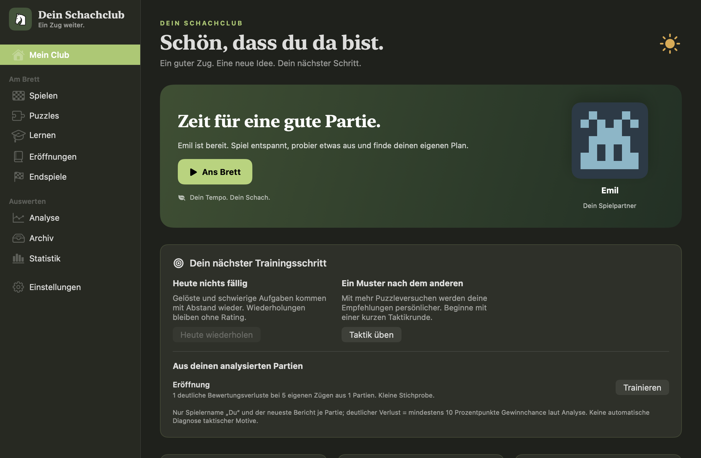
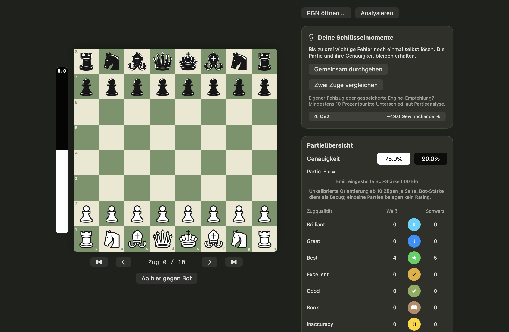
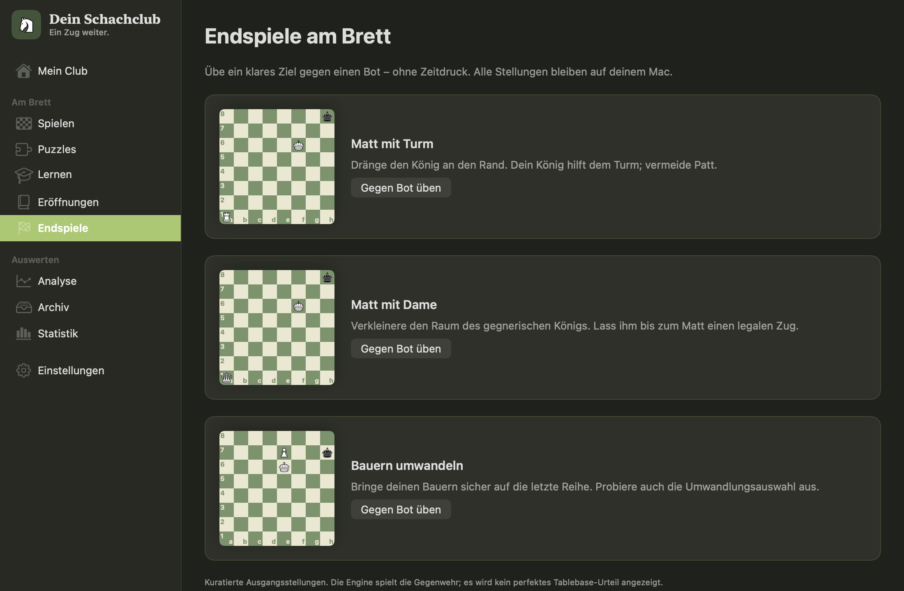

<div align="center">

# ♞ Dein Schachclub

### Ein guter Zug. Eine neue Idee. Dein nächster Schritt.

Eine persönliche Schach-App für macOS und Windows — zum Spielen, Verstehen und Besserwerden.

**Offline · Einzeltraining · SwiftUI für Mac · C# / Avalonia für Windows · lokale Stockfish-Engine**

[App herunterladen](https://github.com/LeoB070/SchachApp/releases) · [Loslegen](#auf-deinem-mac-loslegen) · [Stockfish installieren](#stockfish-die-engine-hinter-dem-brett)

</div>



Du hast eine gute Stellung erreicht — und sie dann doch noch aus der Hand gegeben?
Hier endet die Partie nicht mit dem Ergebnis. Schau dir die entscheidenden Momente
an, finde selbst einen besseren Zug und spiele die Stellung noch einmal gegen einen
Bot. Später begegnet dir die Idee erneut, bis du sie am Brett wiedererkennst.

**Dein Schachclub ist dein Trainingspartner.** Ohne Konto in der App, ohne
Onlinegegner und in deinem eigenen Tempo. Nach Installation der separaten Engine
bleiben Partien, Analyse und Training auf deinem Mac.

## Was dich am Brett erwartet

Dieser ausführliche Funktionsüberblick beschreibt die **Mac-Version**. Der aktuelle
Windows-Umfang und seine Unterschiede stehen im Schnellstart weiter unten.

| Spielen | Verstehen | Dranbleiben |
|---|---|---|
| 15 Botgegner mit eigenen Pixelporträts, unterschiedlichen Stärken und direkter Revanche | Lokale Stockfish-Analyse mit Bewertungsverlauf, Zugqualität und Eröffnungsnamen | Geplante Puzzle-Wiederholungen nach 1, 3, 7, 14 und 30 Tagen |
| Farbe und Bedenkzeit selbst wählen — oder entspannt ohne Uhr spielen | Bis zu drei Schlüsselmomente selbst verbessern und Zugkandidaten vergleichen | Persönliche Übungsempfehlungen aus deinen protokollierten Ergebnissen |
| Eine Analysestellung separat gegen einen Bot weiterspielen | Sichtbare Brettfolgen statt bloßer Zahlen: Schach, Schlagen und Matt | Eigene Eröffnungsvarianten aktiv trainieren und Endspiele gezielt üben |

### Aus deinen Partien wird dein Training

- **Deine zweite Chance:** Stockfish prüft eigene Fehler und erstellt daraus eindeutige Übungsentscheidungen.
- **Heute wiederholen:** Schwierige Aufgaben kommen mit Abstand zurück. Hinweise und Fehler setzen das Intervall zurück; Wiederholungen verändern dein Puzzle-Rating nicht.
- **Ein Muster nach dem anderen:** 52 kuratierte Puzzles, darunter mehrzügige Kombinationen, mit Themenfiltern und Hinweisen von der Idee bis zum Zielfeld.
- **Meine Eröffnungen:** PGN-Hauptvarianten speichern, eine Farbe wählen und die eigenen Züge auf dem Brett abrufen. Der persönliche Eröffnungsbaum zeigt deine Fortsetzungen samt Ergebnissen und Fallzahlen.
- **Endspiele zum Ausprobieren:** Kleine Übungsstellungen mit konkretem Ziel, etwa Matt mit Turm oder Bauernumwandlung.
- **Dein Archiv:** Partien als PGN importieren, wieder ansehen und exportieren. Trainingssitzungen überschreiben keine Originalpartien.





## Schnellstart: Mac und Windows

Das Repository bleibt privat. Melde dich auf beiden Geräten mit deinem
GitHub-Account an (bei `git clone` über den Git Credential Manager oder vorher
mit `gh auth login`). Für deinen eigenen Account ist keine Einladung nötig. Beide
Apps laufen lokal; Stockfish wird separat installiert. Die Mac-Version bleibt
in Swift, die Windows-Version liegt unter [`Windows/`](Windows/).
Partien und Einstellungen bleiben pro Gerät lokal; zum Austausch von Partien
PGN exportieren und auf dem anderen Gerät importieren. Git synchronisiert den
Programmcode, nicht deine gespeicherten Partien.

### macOS — SwiftUI

Voraussetzungen: macOS 14+, Swift 6 / Xcode Command Line Tools, Git;
bisher auf Apple Silicon geprüft. Stockfish zum Beispiel mit `brew install stockfish`.

```sh
git clone https://github.com/LeoB070/SchachApp.git
cd SchachApp
./make-app.sh
open dist/ChessApp.app
```

Für den Entwicklungsstart genügt `./build.sh run ChessApp`.

### Windows — C# und Avalonia

Voraussetzungen: Windows 10/11 x64, [Git](https://git-scm.com/downloads/win)
und das [.NET 8 SDK](https://dotnet.microsoft.com/download/dotnet/8.0)
(oder ein neueres kompatibles SDK). In PowerShell:

```powershell
git clone https://github.com/LeoB070/SchachApp.git
cd SchachApp
dotnet run --project Windows/ChessClub
```

[Stockfish für Windows herunterladen](https://stockfishchess.org/download/),
entpacken und in der App die ausführbare `.exe` auswählen. Die Engine wird
nicht aus dem Internet nachgeladen. Ohne Engine sind Engine-Bot und Analyse
nicht verfügbar.

Eine eigenständig startbare Windows-App inklusive .NET-Laufzeit erzeugen:

```powershell
dotnet publish Windows/ChessClub/ChessClub.csproj -c Release -r win-x64 --self-contained true -o dist/windows
.\dist\windows\DeinSchachclub.exe
```

Zum Weitergeben den **gesamten Ordner** `dist/windows` zippen. Stockfish ist
separat einzurichten. Der GitHub-Workflow **Windows desktop** baut denselben
Ordner auf Windows und stellt ihn als herunterladbares Build-Artefakt bereit.

Kernprüfungen ohne Oberfläche starten:

```powershell
dotnet run --project Windows/ChessClub.SelfTest -c Release
```

### Aktueller Windows-Umfang

Die Windows-App übernimmt Palette, Startseitenaufbau, Emil-Pixelporträt,
Brettfarben und Originalfiguren. Plattformtypische Controls unterscheiden sich;
die Darstellung ist an die Mac-App angelehnt und nicht pixelidentisch.

| In Windows vorhanden | Bisher nur in der Mac-Version |
|---|---|
| Lokales Spiel für zwei Personen oder gegen Stockfish, vier Botstufen, freie Farbwahl, Umwandlung | Schachuhr und 15 individuelle Botpersönlichkeiten |
| Normale Stellungsanalyse und Tiefanalyse, FEN laden, Partieverlauf durchgehen | Vollständige Partieauswertung mit Accuracy, Zugklassen und Bewertungsgraph |
| 52 Puzzles, Lektionen und Endspielübungen, lokaler Abschlussfortschritt | Puzzle-Rating, geplante Wiederholungen und automatische Aufgaben aus eigenen Fehlern |
| Eröffnungslexikon, PGN-Import/-Export und lokales Partienarchiv | Eigene Eröffnungsvarianten aktiv trainieren und persönliche Trainingsempfehlungen |
| Helle/dunkle Darstellung, fünf Brettfarben und drei Figurensätze | Vollständige Funktionsgleichheit der beiden Apps |

Die Windows-Daten liegen unter `%LOCALAPPDATA%\DeinSchachclub`.
Beim normalen Beenden wird eine gespielte Partie archiviert; eine laufende
Partie wird nach einem Neustart nicht automatisch am Brett fortgesetzt.

### Tiefanalyse

Die Tiefanalyse untersucht die **aktuell angezeigte Brettstellung**, nicht
automatisch jede Stellung der gesamten Partie. Sie verwendet ein eigenes Ressourcenprofil:
verfügbare CPU-Threads und RAM werden automatisch erkannt, mit Reserven für
Betriebssystem und Oberfläche. Normales Spielen behält seine eigenen Parameter.
Die Oberfläche zeigt die gewählten Ressourcen sowie den tatsächlichen
Analysefortschritt; eine laufende Suche lässt sich abbrechen. Das Zeitbudget
beträgt höchstens 30 Minuten pro Stellung. Bei 16 erkannten logischen Prozessoren
(z. B. deinem Ryzen mit aktiviertem SMT) verwendet das Profil 14 Threads und
Zieltiefe 30; der Hash-Speicher richtet sich nach dem RAM und ist auf 4 GB begrenzt.

Mehr Threads sind keine garantierte Suchtiefe. Komplexe Stellungen brauchen
auch auf einem Ryzen 7 deutlich länger; entscheidend ist die angezeigte,
tatsächlich erreichte Tiefe. [Stockfish erklärt Threads und Hash](https://official-stockfish.github.io/docs/stockfish-wiki/Stockfish-FAQ.html).

## Auf deinem Mac loslegen

**Voraussetzung:** Mac mit Apple Silicon (M1 oder neuer), macOS 14 oder neuer.
Intel-Macs sind bisher nicht geprüft. Das Repository ist privat: Du brauchst eine
GitHub-Einladung und musst sie annehmen, bevor du Code oder Releases öffnen kannst.

### Einfach: fertige App herunterladen

1. Unter [Releases](https://github.com/LeoB070/SchachApp/releases) das ZIP der App herunterladen und entpacken.
2. `ChessApp.app` in deinen Programme-Ordner ziehen.
3. Stockfish separat installieren, siehe unten.
4. App öffnen und losspielen. Falls die Engine nicht automatisch gefunden wird, ihre ausführbare Datei unter **Einstellungen** auswählen.

Die App ist lokal ad hoc signiert, aber nicht von Apple notarisiert. macOS kann
beim ersten Öffnen eine Sicherheitsbestätigung verlangen. Nutze dafür die
[offizielle Apple-Anleitung](https://support.apple.com/de-de/102445), wenn du dem
Download vertraust; die Sicherheitseinstellungen müssen nicht global abgeschaltet werden.

### Oder: selbst bauen

Du brauchst Swift 6 und die Xcode Command Line Tools. Volles Xcode ist nicht nötig.
Installiere die Tools bei Bedarf mit `xcode-select --install` und prüfe anschließend
`swift --version`.

```sh
git clone https://github.com/LeoB070/SchachApp.git
cd SchachApp
./make-app.sh
open dist/ChessApp.app
```

Alternativ im privaten Repo über **Code → Download ZIP** herunterladen, entpacken,
im Terminal in den Ordner wechseln und die letzten beiden Befehle ausführen.

## Stockfish: die Engine hinter dem Brett

Stockfish wird **nicht mitgeliefert**. Mit vorhandenem [Homebrew](https://brew.sh/) genügt:

```sh
brew install stockfish
```

Die App sucht automatisch unter `/opt/homebrew/bin/stockfish` und
`/usr/local/bin/stockfish`. Ohne Homebrew geht es über den
[offiziellen macOS-Download](https://stockfishchess.org/download/); wähle danach
die ausführbare Engine-Datei in den App-Einstellungen aus.

**Stockfish ist freie Software unter GPLv3.** Nutzung und Weitergabe sind unter
den Lizenzbedingungen erlaubt. Wer die Engine selbst mitverteilt, muss unter
anderem Lizenz und passenden Quellcode beziehungsweise dessen Bezugsstelle
bereitstellen — auch bei privater Weitergabe. Dieses Projekt nutzt eine separat
installierte Engine als eigenen UCI-Prozess. Siehe die
[offiziellen Stockfish-Hinweise](https://official-stockfish.github.io/docs/stockfish-wiki/Developers.html#terms-of-use)
und [Fremdkomponenten](THIRD_PARTY.md).

## Dein Fortschritt gehört dir

Partien und Lernfortschritt werden lokal gespeichert. Es gibt keinen App-Login,
kein Matchmaking und keine Synchronisierung mit einem Server. Eigene Partien
werden am Spielernamen **„Du“** erkannt; importierte fremde Partien gelten nicht
automatisch als deine Ergebnisse. Sichere deine Daten selbst, wenn du auf einen
anderen Mac wechselst.

Ein paar ehrliche Grenzen: Die Aufgabensammlung ist bewusst klein. Bot-Elo und
geschätzte Partie-Elo sind Trainingsorientierungen, keine offiziellen Wertungen.
Empfehlungen zeigen ihre Fallzahlen; wenige Versuche ergeben noch kein belastbares
Schwächenprofil. Der Eröffnungstrainer importiert die PGN-Hauptlinie, keinen
vollständigen Variantenkurs. Endspieltraining ersetzt keine perfekten Tablebase-Urteile.

<details>
<summary><strong>Für Neugierige: Technik und Checks</strong></summary>

SwiftUI, Core Data, ein eigener Schachkern und ein separater UCI-Prozess.
Keine externen Swift-Paketabhängigkeiten.

```sh
./build.sh build
./build.sh test
sh Scripts/check-play-flows.sh
sh Scripts/check-club-flows.sh
sh Scripts/check-review-flows.sh
sh Scripts/check-puzzle-flows.sh
sh Scripts/check-repetition.sh
sh Scripts/check-training-insights.sh
sh Scripts/check-training-positions.sh
sh Scripts/check-review-candidates.sh
sh Scripts/check-opening-training.sh
sh Scripts/check-navigation-layout.sh
```

`build.sh` verwendet den nativen SwiftPM-Builder. In der Command-Line-Tools-Umgebung
werden die Swift-Testing-Tests kompiliert; die ausführbaren Assertions laufen im
zusätzlichen TestRunner und den Flowchecks.

</details>

---

**Mach aus „Das hätte ich sehen müssen“ ein „Das kenne ich“.**
